<!--  -->

  

## 👋 &nbsp;Hello, World!

## ⚙️ &nbsp;Tech Arsenal

 

  

## 📊 &nbsp;GitHub Dashboard

 

## 🚀 &nbsp;Featured Projects

### 🐍 Eat my Streak

<picture>
  <source media="(prefers-color-scheme: dark)" srcset="https://github.com/Minsu-Agrahari/Minsu-Agrahari/blob/output/github-contribution-grid-snake-dark.svg?raw=true" />
  <source media="(prefers-color-scheme: light)" srcset="https://github.com/Minsu-Agrahari/Minsu-Agrahari/blob/output/github-contribution-grid-snake.svg?raw=true" />
  
</picture>

## 😄 Click for a random dev joke

## 🌐 &nbsp;Let's Connect

 

